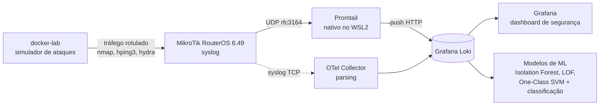

# Detecção de Anomalias em Logs de Rede MikroTik com Machine Learning

TCC de Engenharia da Computação. Pipeline de observabilidade que coleta logs de firewall de roteadores MikroTik, armazena no Grafana Loki e gera um dataset rotulado (tráfego normal + ataques) para treinar modelos de detecção de anomalias.

> Versão pública sanitizada. IPs, hostnames, usuário e proxy foram substituídos por placeholders, e o dump de logs reais da rede foi trocado por uma **amostra sintética** (`sample_logs.json`) — o dataset real não é publicado, por conter tráfego de uma rede corporativa.

## Objetivo

O firewall estático de um MikroTik detecta pouco: em testes, varreduras e ataques volumétricos passaram quase despercebidos pelas regras fixas, e um flood de ICMP chegou a derrubar a rede interna. A hipótese do trabalho é que **machine learning sobre os logs de tráfego** detecta esses padrões melhor que regras estáticas.

O desafio de dados: a rede real gera muito tráfego normal e pouquíssimos ataques reais. A solução é um laboratório que injeta ataques rotulados e controlados, formando um conjunto de validação com ground truth para medir recall, precisão e F1.

## Arquitetura



- **Coleta:** o RouterOS envia syslog; um OTel Collector faz o parsing dos formatos de log (firewall `access forward`, eventos de autenticação, prefixos de ataque do laboratório) e encaminha ao Loki. Por uma limitação de UDP no Docker Desktop/WSL2, o caminho UDP é atendido por um Promtail nativo (detalhes em `PROMTAIL_STATUS.md`).
- **Armazenamento:** Grafana Loki, com retenção e limites configurados.
- **Visualização:** dashboard "MikroTik — Security Monitor" com taxa de logs, logs de ataque, top IPs de origem e distribuição por protocolo.
- **Laboratório de ataques:** container Ubuntu com nmap, hping3 e hydra gera dez tipos de ataque (port scan, brute force, SYN/UDP/ICMP flood, DNS amplification, slowloris, ARP spoof) mais tráfego normal como baseline. O script exige confirmação e exibe aviso legal, sendo destinado só a alvo próprio em ambiente controlado.
- **ML:** detecção não supervisionada com seis abordagens (DBSCAN, LOF, One-Class SVM, Isolation Forest, K-Means e um ensemble por votação) sobre 41 atributos, incluindo janelas causais de 5 min, 1 h e 24 h. Aceleração por GPU (cuML) e um serviço de inferência que processa os logs em lotes de 15 s.

## Stack

MikroTik RouterOS 6.49 · OpenTelemetry Collector 0.136.0 · Grafana Loki 3.3.2 · Promtail 3.3.2 · Grafana 11.4.0 · Docker Compose · nmap / hping3 / hydra · Python (scikit-learn, cuML)

## Como subir a stack

```bash
cd Observability
docker compose up -d
# Grafana em http://localhost:3001 (admin/admin) · Loki em :3100
```

Importe `Observability/mikrotik-syslog.rsc` no RouterOS após ajustar `COLLECTOR_HOST`. O laboratório de ataques:

```bash
cd docker-lab && docker compose up -d
docker exec -it lab-atacante-tcc bash
./attack_simulator.sh --target <IP_DO_SEU_LAB> --attack port-scan --duration 60
```

`sample_logs.json` mostra o formato dos dados (resposta da API do Loki), com conteúdo sintético para quem quiser ver a estrutura sem o dataset real.

## Pipeline de ML

O código de treino, avaliação e inferência está em [`pipeline/`](pipeline/README.md): export do Loki, parsing e janelas causais em Polars, os detectores (CPU ou GPU), os testes T1–T6 do serviço de inferência e o scanner em tempo quase real, que publica os alertas de volta no Loki/Grafana. Para testar sem os dados reais:

```bash
cd pipeline
pip install polars numpy scikit-learn joblib requests pyarrow pandas matplotlib
python testes/gera_sim.py          # exports e ataques.csv sintéticos
python -c "import glob, common_features_polars as cf; cf.export_to_parquet(sorted(glob.glob('export/*.txt')), 'pq', dedup='tolerance', dedup_tol_s=0.001, attack_windows=cf.read_attack_windows('ataques.csv'))"
python train.py --parquet "pq/*.parquet" --ataques ataques.csv --out modelos --seeds 1 --device cpu
python test_inference.py --bundle modelos/bundle.joblib --export export/ROTEADOR_1_2026-09-18.txt
```

Os nomes de roteadores e secretarias no código são rótulos genéricos (`ROTEADOR_1`, `SEC_A`...); para uma rede real, edite `UNIT_MAP`, `WAN_IFACES` e `HOST_ANON` em `common_features_polars.py`. As saídas do pipeline (exports, Parquet, `bundle.joblib`) contêm IPs e MACs e estão no `.gitignore`.

## Resultados

Rodada final sobre uma semana completa de tráfego real (18 a 24/09/2026): **70,3 milhões de registros** de 2 roteadores e 3 secretarias, com perda de ~0,008% no coletor UDP. O teste usou 599.870 registros com **25 ataques abaixo do limiar** das regras do firewall (força bruta lenta, varreduras lentas e distribuídas).

**Regras estáticas:** 0 detecções na semana e **0 de 25** ataques detectados, já que as regras só observam a cadeia `input` (tráfego destinado ao roteador).

**Modelos** (limiar no percentil 99,5 dos escores de treino, 5 sementes):

| Algoritmo | Precisão | Recall (registro) | Recall (evento) | F1 | Sinalizados/dia |
|---|---:|---:|---:|---:|---:|
| DBSCAN | 0,634 | 0,714 | 0,920 | **0,672** | 32.079 |
| LOF | 0,512 | 0,706 | **0,960** | 0,594 | 52.430 |
| Ensemble (≥3 de 5) | **0,818** | 0,393 | 0,888 | 0,530 | **6.834** |
| One-Class SVM | 0,423 | 0,497 | 0,904 | 0,457 | 52.859 |
| Isolation Forest | 0,129 | 0,102 | 0,736 | 0,114 | 52.214 |
| K-Means | 0,036 | 0,029 | 0,080 | 0,032 | 52.910 |

A precisão é um limite inferior, porque o tráfego normal não foi rotulado exaustivamente.

**Operação (replay dos 7 dias pelo serviço de inferência):**

| Exigência do ensemble | Ataques detectados | Alertas/dia útil | Alertas/dia de fim de semana |
|---|---:|---:|---:|
| ≥ 3 votos | 23/25 | 673 | 1.484 |
| **≥ 4 votos (recomendado)** | **21/25** | **128** | 652 |
| ≥ 5 votos | 2/25 | 7 | 12 |

- **Latência:** mediana de ~7 min entre o início do ataque e o alerta; força bruta detectada já no primeiro registro (11 de 23 ataques).
- **Capacidade:** 845 ms por lote de 15 s no pico (~7,4 mil registros), uma folga de 18×.
- **Custo:** o treino leva de 0,4 s a 15 s por algoritmo; a rodada completa (Parquet → treino → testes → replay → análise) leva ~2 h 40 min em uma RTX 4060 Ti.
- **Limitação observada:** a taxa de anomalias de madrugada é 10 a 20 vezes maior que a do meio-dia, porque os períodos de baixo volume ficaram sub-representados no treino. Isso explica também o volume maior de alertas no fim de semana.

## Autores

Igor Monteiro Magro e Vinicius Monteiro de Freitas · Orientador: Prof. Fernando Carvalho · Instituto Federal Fluminense (IFF)
